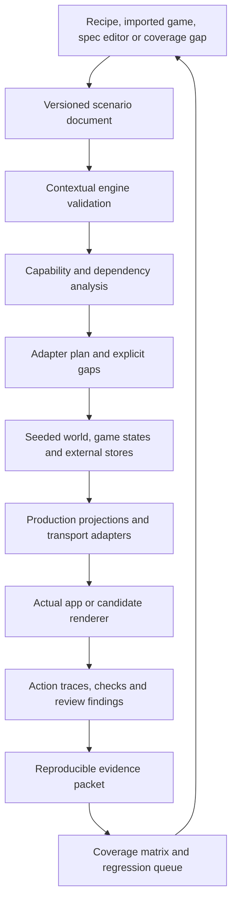

# Gameplay scenario explorer: implementation plan

Status: implementation started. Chunks **0–2 are implemented**. **Chunk 3's headless core is implemented**: shared seeded context facts, per-game states/answer stores, production projections/actions, atomic traces, explicit clocks, reset/checkpoints/fork/pinned resume, CLI/HTTP execution and a stateless browser transport. See [the implementation guide](GAMEPLAY-EXPLORER.md). Chunk 3 remains open for the visible bench/production-frame bridge, snapshot reconciliation and proven persistent caching. The three-case proof currently covers engine/headless behavior; Chunk 4's browser interactions remain open. Arbitrary-game rendering and the new bench workflow are not implemented, and no new visual design is approved.

Baseline: 2026-11-12. Follow the [app review design brief](APP-REVIEW-DESIGN-BRIEF.md), reuse the [UI Atlas](UI-ATLAS.md), and evolve the existing [Gameplay bench](GAMEPLAY-BENCH.md) and [coverage matrix](GAMEPLAY-COVERAGE.md).

## 1. Intended outcome

Build a reusable, engine-driven tool for generating, playing, inspecting and comparing game scenarios. A person should be able to choose a familiar starting game, change compatible mechanics, create a situation, interact with the real application, and record reproducible UX findings.

The tool has two first-class consumers: a person using the interactive bench and unattended automated runners. It must support long-running exploration campaigns that exercise large numbers of definitions, states and action sequences. This is a core architectural requirement, not a script to bolt onto the UI after it is finished. The user's preference for focused checks during implementation is compatible with explicitly requested broad or long-running campaigns.

The normal workflow is:

**Choose a game → create a situation → apply scenario → interact → compare → record findings.**

Support arbitrary engine-valid specs through a common scenario format. Compose data and interaction support from capabilities instead of adding a separate hardcoded fixture for every named game or combination. Use the coverage matrix to identify the next useful case to exercise.

The bench must remain useful when the product is incomplete: it should reproduce a missing or broken UI interaction, explain what is unavailable, and retain the evidence. A fallback lineup preview must never stand in for an unsupported mechanic.

### What “any game” means

- Any submitted spec can be inspected, contextually validated, and analyzed for required capabilities.
- Every required capability has an explicit fixture, renderer, interaction and review status. Unknown requirements are surfaced rather than silently dropped.
- A combination of supported capabilities can generate coherent data and use the same runtime without another named-game branch.
- A new mechanic may require a deliberate adapter or presentation contract. Discovery and gap detection should happen automatically; implementation and good design cannot be inferred automatically from vocabulary alone.
- Testing covers a declared, versioned set of capabilities, boundaries, interactions and journeys. It cannot exhaust every numeric value or every possible combination. Never present a sample count as proof of universal coverage.

## 2. Current foundation and limitations

| Existing piece | Reuse | Limitation to address |
| --- | --- | --- |
| Engine spec, presets, vocabulary, contextual checks and seeded rolls | Authoritative definitions and compatibility checks | The roll generator is an entry point, not the complete universe of supported specs |
| `compileGame`, grammar and rendered-placement declarations | Discover controls, moves, graphics and composed requirements | Compilation does not supply all data or prove interaction support |
| Matrix contracts, stress profiles and evidence ledger | Requirements, gap discovery and scoped review evidence | Compiler witnesses are not executable scenarios |
| Seeded bench state, viewer projection and in-memory commands | Determinism, actual scoring and independent progress | Generation still branches on named recipes and carries lineup-derived configuration |
| Actual application proxy, isolated frames and inspection bridge | Production renderers, request instrumentation and browser inspection | Reads and writes need explicit capability adapters; missing requests must remain visible |
| Export/reset/replay, cached artwork and source fingerprints | Reproduction and review handoff | Broader state stores, schema migration and renderer comparison need common contracts |

Five show recipes currently have generated fixtures: lineup, best ball, Outlast, weekly picks and survival pool. Sports have additional roster/stat defaults. These represent only part of the engine's capabilities. The previous 94 sports-recipe count described league/default combinations, not 94 distinct game types.

Known gaps include prediction sheets, calls, bingo, squares, stages and several sports decision formats. Multi-pick histories and engine commands exist, but the current shared production quick editor selects one participant. Some sports athlete/history projections still use show-event totals. Preserve these as review targets, not hidden fixture corrections.

## 3. Architecture

### 3.1 One scenario document

Define a new versioned scenario contract before adding more recipe-specific configuration. The exact TypeScript/schema representation is a Chunk 1 deliverable. It should distinguish:

| Area | Required information |
| --- | --- |
| Identity and versions | Scenario ID, schema version, seed, generator/adapter versions and source fingerprints |
| Shared world | Show/season or sport/league/event contexts, participant identities, episodes/events, source facts and artwork references |
| Games | One or more game instances, each with its complete spec and context reference; staged games retain child identities |
| People | Stable player/user IDs, membership, roles, participation and independent viewing marks |
| Situation | Clock, timezone, lifecycle position, deadlines, result availability and explicit own-pace/live-only policies |
| Content profile | Quantities, long/wrapped/unbroken labels, missing imagery, varied prompts/options and other applicable stress settings |
| History | Deterministic setup and gameplay actions, supplied results, corrections and expected checkpoints |
| Transport conditions | Scoped latency, failed reads/writes and retry behavior, distinct from genuinely missing application data |
| Presentation | Requested surface, viewport, theme, renderer reference and comparison baseline |
| Evidence | Checks, findings and artifacts linked to the exact scenario revision and exercised journey |

Keep shared episode/event facts separate from game-specific scoring. The same result can affect several games differently while remaining the same result. A show-level cast view must not acquire an arbitrary game's scoring interpretation.

Keep game-definition edits, scenario-state edits and presentation changes distinct. For example, changing the number of allowed picks changes the spec; changing who has submitted changes the situation; selecting a viewport changes presentation only.

Scenario construction may need stores outside `LeagueState`, including specialized calls/bingo/question data and application projections. Do not assume that setting one state object is sufficient to reproduce every screen.

### 3.2 Capability analysis and adapter composition

Analyze the full spec recursively, using production vocabulary, contextual validation and compiler output. Identify acquisition/ownership, counting, scoring, ranking, questions and riders, lifecycle, privacy, context and stage dependencies. Main-page pattern or game name alone cannot determine support.

Each adapter should declare:

- Stable ID/version, matched requirements and required dependencies.
- Facts/stores it reads and produces, with clear ownership to prevent competing writers.
- Applicable controls, contextual bounds and fixed/derived/editable values.
- Deterministic data construction and supported lifecycle transitions.
- Production projections and exact read/write transport bindings.
- Legal actions, browser drivers, effects and assertions.
- Supported surfaces and limitations for this precise capability/context/state.

Resolve dependencies in a deterministic order. Detect missing dependencies, conflicting producers and cycles before launching a preview. An adapter may support fixture data without supporting every UI action; report those separately. Missing one surface should not unnecessarily prevent inspection of another supported surface.

After composition, check for unfulfilled requirements and unused/ignored spec features. A generator that accepts a modifier but leaves its required facts or effects out of the scenario is incomplete even if it returns a valid state object.

Question controls should compose with compatible riders such as confidence, allocations or stakes. Stages should compose child scenarios and their adapters. Do not implement every cross-product as another adapter.

### 3.3 One runtime for UI, HTTP, CLI and automation

All entry points must call the same orchestrator for normalization, validation, analysis, generation, action execution, reset and replay. Avoid a second generator or rules implementation in the browser.

Generate coherent histories using production reducers/domain functions wherever available. If a required production operation lives behind a server service, introduce a reusable testable boundary with injected local providers rather than copying its behavior into the bench. Direct fixture stamping must be explicit, validated and recorded as setup provenance; do not represent it as a successfully completed user action.

Actions target the correct game, event, player and store. Rejected actions must leave the state unchanged. Clock changes and effects on locks/results must replay deterministically; keep wall-clock and unseeded randomness out of reproducible results.

The orchestrator must work without the bench page, an open browser, or a selected human viewer. Automated callers explicitly supply actors, documents, actions and checkpoints and receive structured outcomes. UI session IDs are disposable handles, not the durable identity or storage of an automated case. The current 24-session pilot retention cannot serve as a campaign queue or result store.

Ordinary Atlas frames remain read-only. Bench mutations remain isolated and explicit; unknown requests do not fall through to real application writes. Imported data must use the existing fixture-account rules and exclude credentials/private account material.

### 3.4 Real routes on zt rows (decided 2026-11-12)

The user chose this over pure-builder extraction and hand-built responses: the bench must load real fixtures and the real UI with no duplicated layer, so new screens, API changes and engine updates appear without bench work.

- Each runtime case is **materialized into the local dev database** as zt- rows (people, show, season, schedule, cast, couch, leagues with the runtime's game states, memberships and marks, follows, answers), reusing the `scripts/dev-test/` fixture patterns. `down` removes exactly what `up` made; a non-local database is refused.
- Frames read the **real API routes** as the case's zt user. Every current and future route, and the server-side spoiler/privacy guards, are exercised as they ship. The hand-built response layer (`frame-bundle.cjs`) becomes the fallback for the DB-free headless tier only.
- Writes go through the **real routes**. The runtime replays the same action and compares the resulting game state; a difference is a recorded finding, not silently resolved.
- The runtime stays the source of definitions, seeds, traces and replay. Server wall-clock time is handled by shifting the materialized schedule so the scenario clock maps to now; a clock advance re-materializes.
- The headless runtime remains the fast tier for engine-only brute force; real-route materialization is the UI tier for interactive and campaign UI journeys.

## 4. Bench UX contract

The preview remains the main workspace. Keep context, selected game, viewer, surface, pending changes and support status easy to locate. Avoid exposing the entire engine vocabulary as one large form.

| Control group | Default experience | Deeper inspection |
| --- | --- | --- |
| Game | Context, familiar starting recipe and relevant mechanics/quantities | Compatible modifiers, question composition, stages and complete spec |
| Situation | Players, viewing progress, lifecycle and result state | Individual roles/marks, exact deadlines, partial results and corrections |
| Content | Relevant quantity/content profiles with clear examples | Individual labels/options, fixtures, media substitutions and boundary values |
| Inspect | Actions, results, visible gaps and review notes | Spec paths, projections, component ownership, transport logs and traces |

### Controls and application behavior

- Derive controls from semantic requirements plus explicit presentation metadata: label, units, help, bounds, dependencies and applicable states. Do not generate a raw JSON form and assume it is intuitive.
- Use lineup slots only for manual lineups; roster/best count for best ball; roster size for whole-roster play; picks per round for pick games; question/answer editors, allocations, cards and grids where applicable.
- Sports defaults are useful starting values. The current read-only sports quantities are a pilot limitation, not the eventual testing model. Allow other engine-valid context quantities when their adapters support them.
- Distinguish editable, fixed and derived values. Preserve real context-specific limits, including sports defaults above generic show bounds. Never lower an engine maximum merely to make a design fit. If a fixture exceeds a tool execution budget, report that budget separately from the game's legal limits.
- Explain invalid/incompatible combinations beside the control. Never silently remove a modifier or fall back to a different game.
- Keep edited configuration separate from the running scenario. Show pending changes; **Apply scenario** creates a revision and preserves a recovery point. Save application choices separately from bench configuration.
- Offer a small set of meaningful situations, including “a friend is behind,” with individual controls available for detail. Do not force users to manually recreate an entire history to reach a common test state.
- Switching to a gap must not show stale scores, players, progress or preview content from the previous run. Delayed responses must not restore it.
- Keep an advanced spec editor and import/export available without making them prerequisites for ordinary use. Use accessible labels, keyboard interaction, readable errors and responsive disclosure.

### Support and evidence states

Display independent dimensions, not one “supported” badge:

| Dimension | Example states |
| --- | --- |
| Engine validity | Valid, invalid, context-dependent, engine-gated |
| Fixture readiness | Ready, partial, missing facts/store/adapter |
| Rendering | Unchecked, rendered, failed, unavailable surface |
| Interaction | Unchecked, passed scoped journey, failed, missing driver or missing product behavior |
| Design review | Unreviewed, findings recorded, reviewed for a defined scope |
| User approval | Not requested, changes requested, approved for a named proposal/scope |

Passing fixture/runtime tests can coexist with a failed product interaction. A bench chunk may be complete when it faithfully reproduces and records a product defect; the affected product coverage gate must remain failed or blocked.

## 5. Design process and visual comparison

| Skill | Responsibility in this work | Required output |
| --- | --- | --- |
| Intent | Testing journey, information architecture, decision sequence, recovery and drill-down | Task/state map and reasons for default versus advanced controls |
| Impeccable | Composition, input design, density, typography, feedback, accessibility and responsive behavior | A functioning bench surface with realistic values and clear interaction states |
| Perception-First Design | What is noticed and understood first; cognitive load and processing fluency | First-view assessment of scenario identity, pending edits, next action and support gaps |

Read the actual skills when applying them. This plan assigns responsibilities; it does not claim that all three skills have already reviewed an implementation. If a skill cannot be located, report that accurately and retain its requirements in the review checklist.

Preserve the approved bench's practical visual identity unless a deliberate replacement is reviewed. The app preview should preserve show/sports artwork, expressive data, social information and drill-down. Bench clarity must not turn the app design into a clinical dashboard.

Use real UI/code for controls, charts, scores and labels. Use Nano Banana only when a bitmap asset materially helps; verify availability and cache generated assets/provenance according to [VISUAL-ASSETS.md](VISUAL-ASSETS.md). Do not regenerate existing assets just to repeat a review.

Compare current and proposed renderers from the same initial scenario, clock, viewer, surface and content. Give each renderer an isolated branch for subsequent interactions. Support synchronized scripted journeys without allowing one branch's writes to change the other. Compare equivalent checkpoints, not only opening screenshots.

Present one redesigned bench page with its important supported/gap/error/mobile variants, then pause for user review before extending its visual system. Functional infrastructure and fixtures can progress within authorized scope; that is separate from design approval.

## 6. Coverage strategy

The matrix should request an executable scenario by capability/profile/surface and receive a scenario reference or a precise missing-requirement report. The bench should return evidence tied to that exact request.

Required test sets:

1. Every source-discovered family, primary pattern, answer control, supported ranking/acquisition/counting mode and meaningful modifier.
2. Compatible pairs, plus selected higher-risk combinations: stages, private answers, allocations, mixed pace, deadlines and corrections.
3. Contextual minima/maxima, empty/few/many values, ties, zero versus missing results, long labels/prompts/options and missing media.
4. Full journeys across setup/creation, drafting/acquisition, decisions, save/change, lock, partial/final results, reveal/replay and drill-down where applicable.
5. Permissions/viewing boundaries: self, opponent, commissioner and nonparticipant; own-pace and explicit live-only policies.
6. Multi-game and sports-specific cases, including shared reveals, different event cadence, periods, postponed/cancelled events and corrected statistics.

Maintain distinct suites for valid playable scenarios, invalid-definition/action boundary tests, and explicitly labeled malformed/legacy presentation cases. An invalid spec is not a normal gameplay specimen.

Use deterministic constrained generation and stored engine fixtures, not random sampling alone. Prefer a small suite that covers distinct requirements and interactions; expand when a risk or failure warrants it. Preserve and minimize regressions while retaining the defect's essential conditions.

Evidence identity must include scenario/spec/context, source and adapter versions, input facts, actor/mark/clock, surface, renderer, viewport/theme and exercised trace/checkpoint. Capture whether an action was performed through the UI, invoked directly, or supplied as setup. A screenshot alone does not prove a save or boundary behavior.

Retain curated fixtures with known outcomes and meaningful reconciliation assertions for scoring, allocations, ranking and payouts. Calling the same production calculation twice is not independent evidence that the fixture expresses the intended game correctly.

New vocabulary, compiler placements, fact requirements, API requests and unmapped control descriptors should generate explicit drift failures. Existing acknowledged product defects remain tracked failures; keep the infrastructure regression suite able to verify that those defects are still reproduced accurately. Do not make CI green by silently skipping unsupported features or relabeling them as passing.

### Long-running automated exploration campaigns

Support both bounded exhaustive enumeration of declared finite dimensions and seeded sampling/mutation of larger numeric, content and lifecycle spaces. Do not attempt an unbounded Cartesian product or describe a long run as proof of all possible games. The campaign configuration must state its search space, generator/scheduler version, seed strategy, contexts, constraints, action-depth bounds, test tiers, coverage targets and execution/storage budgets.

Keep the campaign manifest separate from individual scenario documents. A case remains independently reproducible without replaying all earlier cases in the campaign.

| Campaign requirement | Planned behavior |
| --- | --- |
| Stable identity | Case IDs derive from canonical case inputs and relevant versions. Derive each case's seed independently; worker order or a crash must not shift later cases' random values. |
| Resume | Persist the worklist or generation cursor plus completed/in-flight case IDs, attempt outcomes and checkpoints. Recover abandoned leases; do not rely only on the last completed sequential index. |
| Result commits | Commit durable per-case outcomes and checkpoints so interruption cannot produce a false completion. Retries may execute a case more than once, but coverage/results must not count duplicate attempts as distinct cases. |
| Version changes | Pin engine, adapters, generator, renderer and environment signatures. A changed version starts an explicitly linked new run; do not silently resume against different code. |
| Work allocation | Allow bounded concurrency and deterministic sharding. Keep state, identity, stores, transport and browser contexts isolated between cases. Resume must remain correct when worker count changes. |
| Resource control | Cap cases, duration, action depth, per-case time, workers, browser instances, memory and artifacts. Distinguish these tool budgets from legal engine limits. Dispose case-owned resources and monitor growth during sustained runs. |
| Cancellation | Support checkpointed stop and recovery after forced termination. Use a real harness watchdog distinct from the scenario's simulated clock. |
| Fault classification | Distinguish engine rejection, generator defect, missing adapter, product failure, infrastructure failure, timeout and suspected flakiness. Retry only under an explicit policy; retain the original failed attempt. |
| Search efficiency | Deduplicate equivalent cases and report the equivalence rule. Prioritize unexercised capabilities, interactions and boundaries so large runs do not spend their budget repeating common defaults. |
| Scheduling reproducibility | Prefer deterministic schedules initially. If coverage-guided/adaptive selection is added, persist selection decisions; completion timing must not silently change what the run claims to have explored. |
| Failure handling | Group failures by a useful signature while retaining each failing case. Minimize specs/content/action traces using contextual validity and the same failure predicate; preserve both original and minimized reproducers. |
| Artifacts | Record structured events and summaries continuously. Capture necessary failure/checkpoint artifacts rather than a screenshot for every passing case; enforce retention budgets without deleting the sole reproducer for an unresolved unique failure. |
| Human handoff | A case in the campaign report opens in the bench with the same data, actor, clock, checkpoint and renderer. A manually edited case can become a saved regression or campaign input. |

Use staged execution to make high-volume testing practical:

1. **Engine/state tier:** validation, contextual constraints, generation invariants, command sequences, atomic rejection, scores, replay and viewing boundaries. This can run at much higher volume than browser tests.
2. **Projection/transport tier:** coherent response shapes, privacy and actor scopes, serialization, missing reads, allowed writes and state effects through the shared adapters.
3. **Browser tier:** representative capability/interaction combinations, boundary profiles, known regressions and selected campaign cases. Exercise actual actions and resulting persisted in-memory state, not only successful page loads or toast messages.
4. **Review tier:** queue representative and failed experiences for human and skill-assisted UX/design assessment. Automated checks and screenshots do not automatically establish visual quality or user approval.

Include valid-play sequences, intentionally invalid definitions/actions with explicit expected rejection, and labeled malformed/legacy presentation cases. A correctly rejected invalid action passes its rejection assertion, not a normal gameplay or UX gate. Stateful generation should explore meaningful sequences such as submit → change → lock → results → correction → reveal/replay, including different actors and independent pace.

Campaign reports must separately count candidates considered, equivalent cases deduplicated, valid definitions, expected rejections, fixture-ready cases, engine assertions, UI journeys actually exercised, unsupported/blocked cases, unique failures, retries and verified coverage units. Include denominators, source versions, elapsed time, throughput and remaining budget. A million repeated successful engine checks must not appear as a million distinct games or a million UX passes.

The bench should eventually provide a campaign view with Start/Resume/Stop controls, progress, coverage gaps, failure groups and direct case drill-down. CLI/automation remain complete entry points even when that view is closed. No automated campaign is launched merely by adding these requirements to the plan.

## 6A. Revisions (Claude, 2026-11-12; adopted by the user the same day: "whatever you suggest")

Written after building chunks 3, 4 and 4A and after the user's real-routes decision (§3.4). The text elsewhere in this plan is unchanged; each item below can be accepted or rejected on its own. The user's framing: the tool serves manual testing, automated testing **and testing UI redesigns**.

### What the real-routes decision changes

1. **"Transport adapters" become materializer coverage.** With frames reading the real API, supporting a mechanic's screens means writing its stores as zt rows (league state, `game_answers`, bingo cards, calls, waiver claims, chat…), not shaping its responses. Chunk 8's "connect their actual data stores and endpoints" and Chunk 10's transport work shrink to: materialize the store, map its writes to runtime actions, compare. The DB schema is a much stabler boundary than response shapes.
2. **Add a real-route API tier between engine and browser.** Materialize campaign cases and read the real routes as each person, with no browser (as `check-bench-live-db.js` does). Assert:
   - (a) agreement with the runtime projection;
   - (b) a **spoiler/privacy oracle**: for each person, collect the facts they must not see (exits and moments past their mark, opponents' pending choices and answers), then scan every JSON response they receive for them. "Never spoil" is principle 3; this checks it across thousands of generated situations and against the real server's guards, which the engine tier can't reach.

   This tier is cheap enough to run at hundreds of cases.
3. **Snapshot reconciliation and cross-case caching drop out of Chunk 3's exit.** v1 exports keep working through the pilot until it's retired (below). Caching waits until profiling shows a need; per-case workers and fresh DB rows already give isolation.
4. **Writes need a policy, not just refusal.** Today a live frame refuses any write the runtime doesn't model. For social and preference features (chat, reactions, GIFs, settings), which are product value and part of the Tonight design, allow them as **untracked** writes: recorded and cleaned up, but not compared. Keep compared writes for gameplay, and refuse only what could leave the local zt scope.

### For testing UI redesigns (the biggest gap)

5. **A renderer is an app origin.** The frame proxy already targets one app URL. A candidate design is a running branch of the real app (a worktree dev server on another port, as the lanes already use), not a static mock. Because both servers read the same local DB, a materialized case can be shown in the current and the candidate app side by side with no new data work. To keep branches isolated (§5), materialize **one copy of the case per renderer**, under two keys, with the same seed and trace.
6. **Host surfaces come first.** The bench's surfaces are the game page, quick action, detail, reveal and creation. The active redesign work is Tonight, Episodes and the hub, which the bench can't open (Chunk 4's `bench-no-episodes-surface` finding). With real routes, adding them is an entry per route. Seed social content too (chat, reactions, GIFs, recaps; `new-fixture.js` already has a `seedChat`), or Tonight's recap and discussion sections render empty.
7. **Automatable UI oracles, run on generated cases in both renderers.** Not a design review, but cheap and broad:
   - a due action visible in the first 390 px viewport (principle 6);
   - no horizontal overflow;
   - no indistinguishable choice labels (Chunk 4's `answer-faces-indistinct`);
   - every control has an accessible name;
   - no 4xx or console error, and no hidden data appearing (the spoiler oracle again, on rendered text).

   These run in the browser tier on representative and failed cases, before human review.
8. **Move the core of Chunk 11 to just after Chunk 5.** Side-by-side renderers, synchronized checkpoints and a review packet are what redesign work needs now. Chunk 11's remaining parts (finding attachment to source components, packets for Intent/Impeccable/PFD) can follow.

### Condensing the chunks

9. **Fold Chunk 6 into campaign generators.** "Find a valid witness for a matrix requirement" is a generator constrained to that requirement. Make generator families keyed by matrix requirement; a gap is a requirement no family can produce yet. One mechanism then serves the matrix, campaigns and the bench's case picker.
10. **One definition of done per capability for chunks 7–10.** Each subtask lands the same layers, which makes the breadth program mechanical and reviewable:
    - runtime profile support and actions;
    - a generator family with invariants;
    - materializer rows;
    - a real-route agreement and privacy check;
    - a UI driver;
    - recorded product findings.
11. **Retire the v1 pilot path when v2 covers its recipes.** The pilot form can emit v2 definitions; then `scenario.cjs`'s hand-built states and the shaped `frame-bundle.cjs` tier stop being a second generator. This removes the remaining duplication and the reconciliation question.
12. **Split Chunk 12.** The campaign view belongs with the bench (after Chunk 5). Drift checks and docs belong to each capability's definition of done. What remains in 12 is scaling and soak policy.

### Gaps found while building

13. **Production read-path normalization.** The server's read path mutates state (`readyLeague`: `ensureNextEpisode`, bot moves, due waivers, draws, auctions); the headless runtime doesn't. Either the runtime runs the same normalization through a pure entry point, or the API tier's agreement check stays the oracle for it. Chunk 4 hit one case: an all-released world grows an episode on the server.
14. **Wall-clock time in the live tier.** The server has no injectable clock, so schedules are shifted relative to now. That is fine at day scale, but a deadline within minutes of the shifted now can flake. Live cases should keep deadlines at least an hour from any step, and say so.
15. **Bench drivers should use product markers, not "the first button".** The Quick action surface taps the first strip button, which after a reveal can open a recap. Drivers should target semantic markers (`data-game-strip="move"`, `data-starter`, `data-question`), and missing markers are worth adding to the product, since they also serve tests.
16. **People views side by side.** Spoiler testing is clearest with two people at different marks in adjacent frames (each with its own origin, as live viewers already have).

### Progress on these (2026-11-12)

- Done: host surfaces (item 6, with social seeding), renderer = app origin with per-worktree databases and isolated copies, plus a paired-capture script (items 5 and 8, core), the write policy (item 4), and a first spoiler oracle with a positive control (item 2, in the DB check). The Chunk 4 proof now checks the graded sheet on Episodes.
- Also done: the API tier as a campaign tier with agreement and spoiler checks (B; 40/40 after fixing two fixture incoherences it exposed), and browser-tier UI oracles across renderers (first part of D).
- Done: the bench design pass (A). The bench-v2 mock was approved by the user on 2026-11-12 and built as the explorer page at `/__atlas/explorer` (docs/GAMEPLAY-EXPLORER.md, "The explorer page"). Impeccable only; Intent/PFD questions as a checklist in the surface brief.
- Also done: the four product fixes the runs found (Tonight's false finish plate, first-name-only faces, the behind player's moves sheet, the three-pick editor).
- Done: the recipe form as v2 definitions (§6A item 11). Every show recipe, situation, pace and preset opens in the shared runtime and the explorer. The old bench now remains only for sports recipes, which need generated sports statistics in the runtime.
- Done: the first breadth capability, **side bets**, through every item of the definition of done (docs/GAMEPLAY-EXPLORER.md, "Capability: side bets"). Two findings await the user: the new app can't post or settle bets, and the classic state route exposes results and open guesses.
- Done: the second capability, **season-long questions** (who wins, the final three), through every item of the definition of done, finale results included (docs/GAMEPLAY-EXPLORER.md, "Capability: season-long questions"). Two UI gaps went to **Designs needed**.
- Done: the third capability, **head to head** (`rank.by: 'matchups'` with its odd-one-out, quiet-night and playoff riders), through every item of the definition of done (docs/GAMEPLAY-EXPLORER.md, "Capability: head to head"). Its UI gaps went to **Designs needed**.
- Done: the fourth capability, **weeks won** (`rank.by: 'weeks'` with its tie rules; docs/GAMEPLAY-EXPLORER.md, "Capability: weeks won"). Its UI gap joined item 3 of **Designs needed**.
- Done: the fifth capability, **only some moments count, and hits** (`score.only` as a list, `score.hits`; docs/GAMEPLAY-EXPLORER.md). Its UI gaps are **Designs needed** item 4. Before it, 153 of 1,312 show specimens passed the runtime profile.
- Done: the sixth capability, **lives and co-op** (`score.lives`, `livesOn`, `saves`, `rank.by: 'coop'`, survival pools with lives; docs/GAMEPLAY-EXPLORER.md). The runtime now refuses answers as the server does once someone is out or the game has ended, which also covers head to head's final. Also fixed: the explorer page refreshes after saves and reveals made in the app.
- Done: the seventh capability, **shared points** (the `share` rider, plus who-did-it moment questions; docs/GAMEPLAY-EXPLORER.md). Generated results now often follow the couch's answers, so right answers happen in walks.
- Done: the eighth capability, **drafts out of a hat** (`get.order: 'draw'`; docs/GAMEPLAY-EXPLORER.md). Also fixed: the runtime now counts only the answers that count once someone is out (`liveRows`), as the server does.
- Done: the ninth capability, **stakes and banks** (`wager`, `odds`, `score.bank`; the server's stake limits mirrored in the runtime; docs/GAMEPLAY-EXPLORER.md).
- Done: the tenth capability, **settled by the couch** (`settle.by: 'players'`; docs/GAMEPLAY-EXPLORER.md).
- Done: the eleventh capability, **races and cuts** (`rank.race`, `rank.cut`; docs/GAMEPLAY-EXPLORER.md). Found a product bug: someone cut is still offered their lineup (BACKLOG 47).
- Done: the twelfth capability, **phases** (spans from or to a phase; "When does the merge start?"; the season rulebook's phase starts materialized the desk's way; docs/GAMEPLAY-EXPLORER.md).
- Done: the thirteenth capability, **bounties** (`score.bounty`: who voted for whom, materialized as the season's research rows the server reads; docs/GAMEPLAY-EXPLORER.md). 583 to 635 of 1,312 specimens run.
- Done: the fourteenth capability, **teams of players** (`rank.teams`, drawn; seeded from the game's id, kept as the server keeps them; docs/GAMEPLAY-EXPLORER.md). 682 of 1,312 run.
- Done: the fifteenth capability, **parlays** (`score.parlays`: every leg right in a window multiplies their points; the question sheet's paid points checked against the server window by window; docs/GAMEPLAY-EXPLORER.md). 729 of 1,312 run. Its gap is **Designs needed** item 14. Found BACKLOG 48 (a team game with a cut ending at once when every seat is catching up).
- Done: the sixteenth capability, **multipliers** (`score.times`: episode 1's and the finale's windows; each case checked against a twin without them; docs/GAMEPLAY-EXPLORER.md). 766 of 1,312 run. Its gap is **Designs needed** item 15. Found BACKLOG 49 (hits counted once each: the grid doesn't add up to the standings).
- Done: the seventeenth capability, **rollovers** (`rollover`: a window nobody earns on carries its points into the next; the open window's jackpot checked against the server; docs/GAMEPLAY-EXPLORER.md). 809 of 1,312 run. Its gap is **Designs needed** item 16. Also fixed in the runtime: a game with an answer walk ranks by the walk's totals, as the server does.
- Done: the eighteenth capability, **whole-game moment questions**, the first of the other answer kinds (asked once, settled by a moment: who, first, whether, how many; docs/GAMEPLAY-EXPLORER.md). 814 of 1,312 run. Its gap is **Designs needed** item 17 (with item 2). (BACKLOG 50 was filed and then retracted: the runtime's fault, fixed in core-runtime-16.)
- Done: the nineteenth capability, **Weekly Calls** (the show's calls: a person's calls on the context, the calls route mirrored, materialized as episode_calls; the explorer page's frames write them; docs/GAMEPLAY-EXPLORER.md). 825 of 1,312 run. Its gap is **Designs needed** item 18 (How it plays tells the talk-show rule).
- Done: the twentieth capability, **confidence picks** (rank who goes home, surest first; docs/GAMEPLAY-EXPLORER.md). 827 of 1,312 run. Its gap is **Designs needed** item 19 (small). The other answer kinds are a long tail now (four specimens blocked by their kind alone); the next family is the card and `beat` (see the handoff).
- Done: the twenty-first capability, **the weekly card** (a card drawn in turn from the spec's list, only its moments counting that week; docs/GAMEPLAY-EXPLORER.md). 901 of 1,312 run. Its gap is **Designs needed** item 20 (the wrong game's words, and no card). Also fixed in the runtime: the sheet graded on the copy cut at the game's end, as the server does (BACKLOG 50 retracted).
- Done: the twenty-second capability, **beat the bot** (the bot's own call per window, hidden until the lock, materialized as bot_calls; docs/GAMEPLAY-EXPLORER.md). 976 of 1,312 run. Its gap is **Designs needed** item 21 (the bot's calls and the couch's record never show).
- Done: the twenty-third capability, **Outlast in reverse** (the generator's first Outlast games; a paired check against the game played forward; docs/GAMEPLAY-EXPLORER.md). 1,004 of 1,312 run. Found BACKLOG 51 (the page says "Fewest points wins"); its gap is **Designs needed** item 22.
- Done: the twenty-fourth capability, **the top scorer's twist** (its choices per episode, filed and stamped as the server does; the page's twist screen writes them; docs/GAMEPLAY-EXPLORER.md). 1,039 of 1,312 run. Found BACKLOG 52 (own pace: the twist chosen before everyone has played the deciding episode); its gap is **Designs needed** item 23 (small).
- Done: the twenty-fifth capability, **a captain** (named with the lineup; a paired check against the game without one; docs/GAMEPLAY-EXPLORER.md). 1,063 of 1,312 run. Its gap is **Designs needed** item 24 (nobody can name a captain in the new app).
- Done: the twenty-sixth capability, **secret roles** (the deal seeded from the game's id, stamped as the server stamps it; a paired check: nothing on the table before the reveal; docs/GAMEPLAY-EXPLORER.md). 1,091 of 1,312 run. No new gap: the page tells the holder alone.
- Done: the twenty-seventh capability, **a draft spread across tribes** (a world's tribes, in blocks; the generated draft spread as the rule allows, in snake rounds; docs/GAMEPLAY-EXPLORER.md). 1,119 of 1,312 run. Its gap is **Designs needed** item 25 (small). The draft-time rule is the draft room's; pickups need waivers.
- Done: the twenty-eighth capability, **a survival pool's mulligans and buyback** (automatic, the pool's walk; docs/GAMEPLAY-EXPLORER.md). 1,133 of 1,312 run. Found and fixed BACKLOG 53 (mulligans left counted backwards; a buy-back line for someone out with none left); its gap is **Designs needed** item 26. Also fixed: the multipliers twin left side bets out of the factor.
- Done: the twenty-ninth capability, **a pool's second pick** (the pick action's `second: true`, as the route takes it; docs/GAMEPLAY-EXPLORER.md). 1,138 of 1,312 run. Its gap is **Designs needed** item 27 (nobody can make one in the new app).
- Done: the thirtieth capability, **group slots** (a world whose show forms pairs, in the stored answers' format section; the slots settled from them as the server does; the groupSlot action; docs/GAMEPLAY-EXPLORER.md). 1,155 of 1,312 run. Its gap is **Designs needed** item 28 (nobody can fill a slot in the new app); BACKLOG 54 is a question it raised.
- Done: the thirty-first capability, **a pool that skips a night you've used everyone** (automatic, the pool's walk; docs/GAMEPLAY-EXPLORER.md). 1,166 of 1,312 run. Its gap is **Designs needed** item 29; BACKLOG 55 is its wrong words.
- Done: the thirty-second capability, **an auction** (sealed bids generated and settled at setup with the engine's own settle; docs/GAMEPLAY-EXPLORER.md). 1,177 of 1,312 run. Its gap is **Designs needed** item 30 (nothing shows what anyone paid).
- Done: the thirty-third capability, **mid-season waivers** (waivers.js ported: claims in a private store, the waiver clock synced on every action, own pace's shared episode; the claim and freeAgency actions; with it a replacement's multiplier; docs/GAMEPLAY-EXPLORER.md). 1,187 of 1,312 run. Its gap is **Designs needed** item 31. The commissioner's window, Process now and Undo are the next waiver actions.
- Done: the thirty-fourth capability, **the commissioner's waiver actions** (Open a window, Run now, Undo and Pick for them, as Backstage › Waivers and the classic routes run them; a window on a game with no waivers of its own; every waiver write in the bench now compared; docs/GAMEPLAY-EXPLORER.md). Still 1,187 of 1,312 (none was blocked by these, but 480 specimens are drafts whose only waivers are a window opened by hand). Found BACKLOG 56 (own pace with exclusive teams: Run now, Open a window and Undo act on the season as it stands, not everyone's episode) and BACKLOG 57 (own pace: replacing a starter rewrites the weeks already played), both confirmed on the real routes; BACKLOG 58 (a question) and 59 (wrong words after an undo). Its gap is **Designs needed** item 32.
- Done: the thirty-fifth capability, **stages** (first slice: two games split at the merge or at an episode, each stage a game of its own derived from the game's spec, the overall built from their tables as the server builds it, a later stage's draft made as it opens from who's still in; docs/GAMEPLAY-EXPLORER.md). 1,197 of 1,312 run: the 10 specimens split at the merge (the handoff's 19 was a miscount: the other 9 start a new draft on a format change). The second stage's draft was also made on the real routes by the people themselves and equals the runtime's. Found BACKLOG 60 (a later stage's private draft can't be locked in when fewer are still in than a team takes) and BACKLOG 61 (someone behind is shown the next stage's start and their team), both confirmed on the real routes, and BACKLOG 62 (a question: an Outlast stage that starts mid-season starts everyone on points). Its gap is **Designs needed** item 33.
- Next, by how often each blocks the matrix's show specimens (2026-11-13, after thirty-five; `node scripts/dev-test/profile-blockers.js`), and how many it blocks alone (those start running once it's connected):
  - **the rest of stages (22, all 22 alone):**
    - **a stage a format change starts (9): next.** A Weekly Lineup with a "New draft" stage whose `on` names the changes (teams or pairs formed, a split into individuals, the merge, a swap that leaves no group as it was), again each time, taken by itself with an undo (`extras.changes`). The server makes a copy of the stage when research is sure of the change (`change-stages.ts`, `StageLogic.changePlan`, `state.changeStages`), ends the stage before it there, and takes a copy away when a corrected report no longer says it. The runtime's world with pairs (`context.pairs`) already gives research those changes (the thirtieth capability's `researchOf`);
    - **bingo with trivia alongside (13):** Weekly Bingo (`get.by: 'card'`, `score.by: 'lines'`) with episode trivia played alongside (`alongside: true`, `settle.by: 'trivia'`): bingo cards and the trivia key first, each a capability of its own, then the stage alongside (its walk counted outside the state: `outsideCounts`);
  - other scoring bases (37, 12 alone: sports statistics, an explicit gap until the runtime generates a sports world; squares; lines);
  - other answer kinds and question facts (53, 50 alone, but 22 shapes of one to five each: `--kinds`; many are sports settlements: who wins a game, a bracket, a stat leader).

  Blocking no specimen, but found wanting by this one: **the draft room as actions** (a snake's picks, a private draft's lock and reveal, starting a draft). Every draft here is made at setup or, for a later stage, the moment it opens, so a draft still open while its first episode airs is never played, and the draft room's screens are never driven.

  A card the bot chooses or a host writes (3) needs their choice made server-side.

### Designs needed (product gaps the breadth program finds; designed together in one round)

The user, 2026-11-12: build these in the new app, but batch them, since several capabilities will surface gaps of the same kind. Each capability adds its gaps here. When the list warrants it (or the user asks), run one design round through Impeccable covering them all, with one page and its variants for review, before building.

1. **Side bets: posting and settling.** Weekly Lineup has them on by default, but the new app only lets players guess. Needs: where a bet is proposed (anyone playing) and where the commissioner marks guesses right or wrong after the episode, plus how settled bets show (the engine and routes exist; see docs/GAMEPLAY-EXPLORER.md, "Capability: side bets").
2. **Season-long answers once settled.** After the finale nobody can see how their "Who wins?" or "final three" answers did: the game page shows questions only while one is open, and the person sheet lists only per-episode answers (its header still counts all the season's questions). Needs: where settled season-long answers and their points live on a finished game (the game page's end state, the person sheet), and how a finale reads ("Who goes home?" on finale night should lead with who won). The routes already return the verdicts (docs/GAMEPLAY-EXPLORER.md, "Capability: season-long questions").
3. **PRIORITY (the user, 2026-11-12: first when the design round happens; BACKLOG 46). Head to head: this week's matchup and the playoffs.** Nothing shows who you play next (`matchups.next` is in every game view, unread). The playoffs show only "the top N make the playoffs" and OUT marks: no bracket, no champion named, the losing finalist marked OUT like those who missed them, the final's square unmarked in the regular-season grid, and a champion ranked above a better regular-season record with no reason shown. A quiet night (counted for nobody) shows as unexplained dashes. Weeks won has the same family of gap: a week shared under `ties: 'split'` counts half (columns of 2.5 and 0.5) but its square looks like a whole win, with nothing explaining the halves. Needs: this week's matchup (on the page and Tonight), the playoffs (seeds, the bracket as it's played, the champion), and how the grid marks playoff rounds and quiet nights. The routes return all of it (docs/GAMEPLAY-EXPLORER.md, "Capability: head to head").
4. **What scores, when only some moments count or hits are counted.** How it works' "What scores" ("This game's points") lists every moment at its rulebook points even when only two count, each a hit worth 1. The right sentences exist (game-spec describe.js) but don't reach it. The game page says "Only 2 moments count" without naming them, and labels hits as points (PTS, "0 pts"). Needs: What scores and the game page saying which moments count and what each is worth, and hits worded as hits (docs/GAMEPLAY-EXPLORER.md, "Capability: only some moments count, and hits").
5. **Co-op: the lives left on the first screen.** While answers are due, the game page's first screen shows "Together, 3 lives" (the rule, which reads like the count). The couch's lives left (the hearts, the grid's Lives row) are below the questions. Small: the count belongs beside the rule, or in its place (docs/GAMEPLAY-EXPLORER.md, "Capability: lives and co-op").
6. **Shared points' worth.** A split question says "+4" and "4 points if you're right" above "Split between everyone who's right", where a shared pot pays less. The game's summary names only one share rule when its questions use two. Small: word the worth with the share ("4 points, split between everyone right") (docs/GAMEPLAY-EXPLORER.md, "Capability: shared points").
7. **Knocked out; and a drawn game's chip.** Once someone is out, their season-long answers vanish from their sheet (shown as unanswered) with nothing saying they no longer count ("You're out: this doesn't count now" would do). A game whose teams came out of a hat shows the chip "Order drawn": it's the teams that were drawn (docs/GAMEPLAY-EXPLORER.md, "Capability: drafts out of a hat").
8. **Stakes: large amounts.** The stake moves one point a tap; a bank can start at up to 10,000 and "any of your points" grows with your score. Needs quick amounts (half, all in) or typing, kept within "Up to N" (docs/GAMEPLAY-EXPLORER.md, "Capability: stakes and banks").
9. **Settled by the couch: the rider's words.** "Settled by what most of you say happened" reads as a vote on what happened; it's what most (or fewest, for minority) of you answered to the question it names. Small, a words change (docs/GAMEPLAY-EXPLORER.md, "Capability: settled by the couch").
10. **Knocked out of a draft: the page still asks for a lineup.** Someone cut (or everyone, after a race is won) sees "Set your Episode N lineup" as their move while the grid marks them OUT, and the server refuses it. A bug in the game view (BACKLOG 47) as well as a missing state: what the page shows someone who's out (their finish, who's left, what's still theirs to watch). Design the out state with item 7's (knocked out of a game of questions).
11. **Phases: names and a first week.** The summary line says "From merged" (the phase's id, not its name, "Merged"). A game's first lineup says "last week's stands in till then" when there's no last week (docs/GAMEPLAY-EXPLORER.md, "Capability: phases").
12. **Bounties: where the points came from.** The season grid's squares don't add up to the total (Ann's 2, 2.5 and 3 against 19.5): the bounty points sit on no episode, and nothing says whose starter voted out whose. The summary's "Bounties" is the only sign. Needs: each episode's bounties (who took what from whom, and a vote that didn't count because research's counts disagreed) on the grid or the week, and the running total beside the points. The game view has it all (`twists.bounty`, each episode's `voteRecord`; docs/GAMEPLAY-EXPLORER.md, "Capability: bounties").
13. **Teams of players: the teams' own standings.** The page says "In 2 teams" and who's with whom, but not each team's points (4.75 against 2.5) or which is ahead. Your line pairs the team's shared place with your own points ("Tied 3rd of 4 · −0.5 pts"). In an own-pace game, someone still catching up has a team before they're on it, with nothing saying when they join. The game view has the teams (`teams`: members, points, place, rank; docs/GAMEPLAY-EXPLORER.md, "Capability: teams of players").
14. **Parlays: the sheet never mentions the parlay.** Only the summary line says "Parlay pays double". The questions read "+2 · 2 points if you're right" with no word that they're tied together, or that all of them right pays double; a paid parlay then shows "Who goes home? 2 pts … +4" on the sheet with no reason for the 4, and How it plays leaves it out. Needs: each leg saying it's one (and with which), what all right pays beside its own worth, and a paid parlay marked on the week and the sheet. The game view has the legs, `times` and each window's earned points (docs/GAMEPLAY-EXPLORER.md, "Capability: parlays").
15. **Multipliers: which episodes count extra, and the squares that did.** The summary names only the first window ("Episode 1 counts double", chip "×2 EP1"), never the finale's triple. The multiplied squares in the season grid look like any others, and the week's lines show the multiplied points beside the moment's plain name ("+8 · Individual immunity win", normally +4), so they read as wrong. Needs: every window named (the summary, How it plays), a multiplied episode marked on the grid and the week (×2 beside its total, lines at their own points with the factor shown once), and, before the finale, that it counts triple. The engine has the factor for each episode (docs/GAMEPLAY-EXPLORER.md, "Capability: multipliers").
16. **Rollovers: the jackpot's total.** Small, a words change: a rolling question says "Nobody got the last one: +6 rolled into this" under a headline that still reads "+3 · 3 points if you're right", so the total it's worth (9) is never stated. The sheet has the jackpot (docs/GAMEPLAY-EXPLORER.md, "Capability: rollovers").
17. **Questions about the whole game: points with no square.** (Item 2's family, wider.) A game whose questions are about the whole season (who finds an idol, who wins immunity first, will anyone go to Exile, how many reward wins) pays as each settles: Ann has 3 points before the finale and 9 after, yet every square in the season grid is 0, her sheet says "Nothing was asked that episode", and the only mention of the questions is How it plays, as rules. Nothing shows her answers, which settled and when, what each paid, or which still wait. Also the words "0 a episode". Design with item 2: where whole-game answers live on the game page and the person sheet, through the season and at its end. The routes return every verdict and payout (docs/GAMEPLAY-EXPLORER.md, "Capability: whole-game moment questions").
18. **Weekly Calls: How it plays tells the wrong rule.** A words fix, but it misleads: on a show whose calls the season's results settle (Survivor: who goes home, and whether a moment happened), How it plays says "The couch says what happened as it watches: two of you agreeing settles a call". That's a talk show's rule (describe.js says it for every Weekly Calls game; src/new/games.ts's Weekly Calls blurb says it too, and "For talk and variety shows"). The words need the show's kind (results or couch): what settles a call, and when you'll know. Also "1 a episode" (item 17's words). The page and the Call it sheet otherwise read well (docs/GAMEPLAY-EXPLORER.md, "Capability: Weekly Calls").
19. **Confidence picks: the worth.** Small, a words change, item 16's family: "Rank who goes home, surest first" headlines "+1" when the surest pick is worth 3, and the sheet later shows "1 pts" beside a +2. The rank numbers on the faces and How it plays ("3 for the first") are clear; the headline should say up to 3 (docs/GAMEPLAY-EXPLORER.md, "Capability: confidence picks").
20. **The weekly card: the wrong game, and no card.** A pick game where only each week's card counts (three of a list of moments, in turn) calls itself a Survival Pool ("PICK A SURVIVOR"), and its pick sheet asks "Who survives Episode 2? Streak 1. Not someone you've used.": there's no streak, nobody goes out, and this one lets you pick someone again (`repeat: 'any'`). The engine types every pick game `pickem`, so these words likely reach any pick game scored by moments; check them in the round. Neither the page nor the sheet names this week's card (Idol/advantage found, Individual challenge: 3rd place, Reward win), so nobody knows what their pick needs to do. How it plays names the list by ids ("rewardWin, individualImmunity, …"). Needs: the game named for what it is, this week's card where you pick (and on the week), the moments by their names, and how a pick did against its card (docs/GAMEPLAY-EXPLORER.md, "Capability: the weekly card").
21. **Beat the bot: the bot's calls and the couch's record never show.** The rule reads well ("Beat the bot: score only where it's wrong" on each question, a summary chip, How it plays). But once a window locks, the bot's call appears nowhere: Ann's sheet says "Who goes home? Cameron · Cameron went home · 0" with nothing saying the bot named Cameron too. How the couch did against the bot (its calls settled and right, each person's beat and beaten: the game view's `bot` line) isn't on the page. Small too: for a person question "2 points if you're right and it isn't" is looser than the rule (a right pick the bot didn't name scores, even when the bot was right about someone else). Needs: the bot's call beside each settled answer, and the couch against the bot as a line of its own (docs/GAMEPLAY-EXPLORER.md, "Capability: beat the bot").
22. **Outlast in reverse: the page's note and the week.** The note "Fewest points wins" is wrong (BACKLOG 51: the most points win), and the sheet's episode by episode reads a running value as points scored ("+22 (Ep 1)", then −2 and −1, "6.3 a episode"): in reverse a castaway still in is worth what they'd score going home next, which shrinks as they outlast boots. How it plays says it right ("the earlier yours go home, the better"). Needs: the reverse rule where the table is, and each episode as what it changed (who went home and what they banked), not a delta of a running value (docs/GAMEPLAY-EXPLORER.md, "Capability: Outlast in reverse").
23. **The top scorer's twist: who chose it.** Small. The choice itself works well on the page ("Your twist · Pick a twist · You topped Ep 1 · by Sat 1:04 AM", the twists as options, saved and replayed). Once filed, every seat sees a chip "×2 EP 2", but nothing says who chose it, or that it was chosen rather than the fallback, and Episode 2's week doesn't mark its points as doubled. While it's open, the others don't learn someone is choosing. (The twist route's comment still says "No screen yet"; there is one.) Needs: the twist named with its chooser on the week it plays (docs/GAMEPLAY-EXPLORER.md, "Capability: the top scorer's twist").
24. **A captain: nobody can name one.** The game page says "Captain scores double", but the lineup sheet ("Start 2 of your 2. Tap to start or bench.") has no way to name a captain, and nothing in the new app sends one (the lineup route takes `captainId`; only the start-a-game wizard mentions captains). So the multiplier never applies to anyone in the new app. How it plays doesn't mention the captain either, and a captain's doubled line shows as plain points ("8 · Individual immunity win", normally 4). Needs: naming a captain where you set your lineup (the armband on one starter, carried until changed or benched), and the captain marked on the week (docs/GAMEPLAY-EXPLORER.md, "Capability: a captain").
25. **A draft spread across tribes: the summary and the team.** Small. The summary line says "1 from each tribe" for a team of four across three tribes (it's 2, 1 and 1: How it plays has it right, "as evenly as its size allows"), and the team never shows anyone's tribe, so nobody can see the spread (docs/GAMEPLAY-EXPLORER.md, "Capability: a draft spread across tribes").
26. **A survival pool's mulligans and buyback: what happened to you.** The page names the rules (a "Buy back in" badge, "1 wrong pick forgiven") but never what happened. Ann bought back in after episode 1: nothing says so or that it cost her 3 points; the season grid shows that night as a plain ✗ and her points (−2) are on no screen. A forgiven pick also shows as a plain ✗ with nothing saying it was forgiven, and no line says how many mulligans are left on this layout. Needs: on the season grid and the sheet, a forgiven pick and a bought-back night marked as such (with the cost), and the lives, mulligans and buybacks left where the pick is made (docs/GAMEPLAY-EXPLORER.md, "Capability: a survival pool's mulligans and buyback"; the counting bug itself was BACKLOG 53, fixed).
27. **A pool's second pick: nobody can make one.** The game page says "A second pick" and How it plays explains it ("You can pick a second castaway beside the first. It counts on an episode two or more go home"), but the pick sheet ("Who survives Episode 2?") takes one castaway and nothing in the new app sends `second: true` (the picks route takes it). Needs: a second pick on the sheet, beside the first and never the same, with the night it counts said plainly, and the second marked on the season grid (counted, void, right or wrong) (docs/GAMEPLAY-EXPLORER.md, "Capability: a pool's second pick").
28. **Group slots: nobody can fill one.** The game page says "Plus a tribe slot" and shows a "Group slots" chip, but the lineup sheet has only the draft's starters and nothing in the new app sends the group-slots route's PUT (the route's own comment: "No screen yet (U1's)"). Needs: the slot on the lineup sheet with the pairs or teams on offer going into the episode (their people, and who holds them in an exclusive game), what it holds while it rides, why it dropped or was void, and its points on the week (docs/GAMEPLAY-EXPLORER.md, "Capability: group slots").
29. **A pool that skips a night you've used everyone: the page calls it a miss.** Ann's sheet says "No pick · missed" and "Waiting" for a skipped night, though nothing counted against her (her streak held, no life lost). The rules shown say "a wrong pick, or no pick, costs one" with nothing about the skip, and the page still asks her to pick when nobody is left she hasn't used. Needs: a skipped night said as one ("Skipped: you'd picked everyone still in") on the grid and the sheet, the rule in How it plays, and the pick move saying there's nobody left to pick this week (docs/GAMEPLAY-EXPLORER.md, "Capability: a pool that skips a night you've used everyone"; the wording bug is BACKLOG 55).
30. **An auction: what anyone paid.** The page names the auction ("Bid for 3", an "Auction" chip; How it plays explains the bidding), but nothing says what each castaway cost, what's left of the budget, or which places were filled at the lowest price (Ann won one at 5 and was filled with two at 1). Needs: each team's prices and what it spent, the filled places marked, on the team and the person sheet (docs/GAMEPLAY-EXPLORER.md, "Capability: an auction"). The draft room itself (placing sealed bids) is the U1 draft room's.
31. **Mid-season waivers: what you're owed.** After a week processes with no claim from Ann, the waivers screen says "No change for you · No pick in", with nothing telling her she still has a loss to replace (in free agency, or filled automatically when the week closes), and nowhere says a replacement scores half in this game (score.multiply). Needs: the owed replacement on the screen and on Tonight while free agency is open (and what happens at the close), and the replacement rule where you claim (docs/GAMEPLAY-EXPLORER.md, "Capability: mid-season waivers").
32. **Whoever runs the game and its waivers: what the week is doing.** Backstage › Waivers works end to end (a window opened on a game with no waivers, a pick sent for someone, Run now with its preview, Undo, Turn off; every write checked against the runtime). What it doesn't say, or says wrong:
    - **A held week.** After Undo the week waits for Run now or the next episode, but Backstage and the players' waivers screen still give its old time ("due Sat 7:22 AM", "Or on its own, Sat 7:22 AM"). Needs the hold said, with what ends it (BACKLOG 59).
    - **A window turned off.** On a game with no waivers of its own, a window turned off can't be opened again for that episode, yet the screen offers "Open a waiver window" and the refusal talks about processing. Opening a window offers an Undo that turns it off, which then locks the week. Needs the state said ("Off for Episode 1: the next can open after Episode 2"), or the rule changed (a question).
    - **How long people get.** A window opened a little more than a day before the next episode runs within minutes (BACKLOG 58), and the sheet never says when picks will be due before you open it.
    - **A game with none.** Its page carries a "Waivers" chip though nobody is ever replaced (its settings read "No replacements · you open windows"): the chip names a setting, not what happens.
    - **Own pace with exclusive teams.** Run now, Open a window and Undo misbehave there (BACKLOG 56). Beyond the fix, what Backstage should offer when the week belongs to everyone's episode, not the calendar, is undesigned.

    (docs/GAMEPLAY-EXPLORER.md, "Capability: the commissioner's waiver actions".)
33. **A game in stages: its page, its stages and the moment the next one opens.** The pieces exist: the game's page is the overall ("Each stage keeps its own season, a grid of its own on its page: open one above. This is the overall."), with a strip of its stages ("NOW Before the merge · NEXT Merged", then "DONE · NOW") that opens each stage's own page; a finished stage says "Final · You finished 1st · Through Episode 3". What's missing or wrong:
    - **Who can start one, and own pace.** Only the desk's engine lab makes a game in stages, and it makes them live. Start a game refuses one ("A game in stages can't start from here yet"), and Start a game is the only thing that turns a whole game's own pace on, so no staged game plays at its own pace today, though own pace is meant to be the default. Nothing in the engine forbids it (the overall is already right at each person's mark). What's missing: the door, something to pace each stage as it starts (its start isn't known until the merge), and a later stage's draft when everyone is on a different episode. (The per-person switch that had to be set stage by stage is gone: since 2026-11-13 when moves lock is the game's setting, set once on a game in stages and followed by its stages; docs/PLAN-own-pace-games.md.) The runtime keeps own pace in stages a named gap until there's a product path to follow.
    - **The game's page says "All set" while a stage has a move due.** "All set · Nothing to do before Ep 3" on the game, "Set your Episode 3 lineup" on its first stage. The overall carries none of its stages' moves. Your moves has a tab for the stage that's over beside the one that can be set, and its text also carries "Stages · No episode to set a lineup for yet" and "Your team shows here once the draft's done" (the game itself, it seems: worth a look when designing).
    - **The overall is one number.** Nothing shows what each stage gave each seat, though the walk has it.
    - **A stage waiting for the merge invites a draft that can't open.** Its hero says "Starts when Merged starts · Nothing to do yet", then the move plate becomes "Draft · Not started yet · Pick in private, reveal together" once the draft's own read arrives (`your-move.ts` shows any draft that isn't done). The server refuses to start it until the merge is known.
    - **The next stage's draft, mid-season.** Not driven yet (the runtime makes that draft itself: the draft room as actions is its own capability), so undesigned as far as the explorer can say: who is told the merge opened a draft, how long they have (until the next episode's lock), what the stage shows while it's open, and what happens to a seat that hasn't drafted when the episode airs. With too few left for a team nobody can lock one in at all (BACKLOG 60).
    - **An exclusive draft played shared.** When everyone's places no longer fit among who's still in, the stage is played shared from then on; only a line in the stage's Recent changes says so.
    - **Someone behind.** Bo, up to Episode 1, sees the Merged stage headed "Ep 4 · From merged", a column for Episode 4 and "Reveal Episode 2 first": the merge came in Episode 3 (BACKLOG 61).
    - **An Outlast stage that starts mid-season** shows every team on points before its first episode, which the overall doesn't count until then (BACKLOG 62, a question).
    - **Words.** "Redraft at merged", "until merged starts", "From merged" (the phase's id, as item 11); "Before the merge:" twice in How it plays; a new stage's first lineup says "last week's stands in till then" and "Your last lineup carries over" with no last week.

    (docs/GAMEPLAY-EXPLORER.md, "Capability: stages"; words in `.ui-atlas/explorer-page/stages-page.json`, screenshots `05zzc` to `05zzi`.)

### Suggested order from here

A. Bench for redesign testing: host surfaces, social seeding, renderer = app origin side by side, situation controls (viewer, clock, results, reveal) and opening campaign failures. Designed through Intent, Impeccable and PFD; one page for review.
B. The real-route API tier with the spoiler/privacy oracle, run as a campaign tier.
C. The breadth program (7–10) under the per-capability definition of done, prioritized by the matrix (9).
D. Browser-tier UI oracles over campaign cases on both renderers; the campaign view.
E. Retire the pilot path; scaling and soak policy.

## 7. Implementation chunks

Chunks 0–2 below are implemented; chunks 3–12 remain planned. Current pilot functionality is reusable input, not completion of those remaining chunks. Each chunk should be reviewable on its own and leave existing reproduction paths usable.

Milestone evidence for 0–2: three preserved synthetic v1 exports and a frozen source/requirement manifest; structural v2 validation and lossless legacy archival; recursive arbitrary-spec analysis; planner conflict/cycle/dependency checks; additive CLI and local API entry points. The broader backend milestone suite passed 58 tests. These are contract/engine/proxy checks, not new product UI or design evidence.

| Chunk | Deliverable | Dependencies | Exit evidence |
| --- | --- | --- | --- |
| 0 | Baseline and coverage vocabulary | None | Current support inventory, representative exports and agreed status definitions |
| 1 | Versioned scenario document and compatibility import | 0 | Validated round-trip imports; old fixtures retain their meaning |
| 2 | Capability analyzer and adapter planner | 1 | Arbitrary specs yield deterministic requirements, dependencies and precise gaps |
| 3 | Composable runtime, facts and action traces | 2 | Shared orchestrator reproduces state across CLI, HTTP and replay |
| 4 | Three-case architectural proof | 3 | Lineup, multi-pick and prediction cases use the same contracts end to end |
| 4A | Resumable headless campaign runner | 3–4 | Deterministic cases, checkpoint/resume, cancellation, isolation and structured result accounting |
| 5 | Bench workflow and semantic controls | 2–4 | One functioning page reviewed across supported/gap/error/mobile states |
| 6 | Matrix-driven exploration and test selection | 4–5 | A matrix requirement opens a reproducible scenario and receives scoped evidence |
| 7 | Remaining gameplay capabilities and question composition | 4, 6 | Acquisition, scoring, ranking, modifiers and answer controls have fixtures and explicit interaction status |
| 8 | Calls, bingo and squares adapters | 3, 6 | Specialized stores, actions, grading and geometry are exercised |
| 9 | Recursive stages and hybrid games | 7–8 | Child identities, transitions, parallel play and overall scoring reconcile |
| 10 | Lifecycle, social pace and sports breadth | 6; relevant adapters | Shared reveals, permission boundaries, event cadence and corrections are exercised |
| 11 | Renderer comparison and actionable design findings | 5–6 | Same-scenario branches, comparable journeys and linked findings work |
| 12 | Campaign scaling, regression automation and durable handoff | 4A, 6–11 | Declared coverage suite, resource stability, stale-evidence handling and repeatable review packets |

### Chunk 0 — Establish the baseline

- Record supported capabilities per context, surface and action, including current false assumptions and known product defects.
- Preserve representative current exports/replays, artwork references and existing Atlas entry points. Keep durable regressions outside disposable `.ui-atlas` output.
- Separate counts for source capabilities, generated specimens, runnable interactions, reviewed units and user-approved designs.
- Decide how known product failures are represented in tests without being mistaken for bench regressions or passes.

**Acceptance:** the inventory accurately explains why a three-pick history can be generated while the quick editor cannot submit it. No coverage status changes merely because this plan exists.

### Chunk 1 — Define the scenario contract

- Specify schema/version handling, stable identities, context references, games/children, external stores, clock, action history and presentation revisions.
- Include multiple games and independent viewer marks now; avoid another single-game-only format.
- Import current version-1 exports through a compatibility boundary. Preserve originals and report migrations/version mismatches rather than silently rewriting evidence.
- Remove unrelated starter/bench aliases from the new public configuration. Translate legacy values only at the compatibility boundary; preserve each mechanic's actual quantities in new exports.
- Permit direct full-spec input, including specs the roll generator does not create. Negative test cases use an explicit mode.

**Acceptance:** round-trip a current fixture and a two-game scenario without losing specs, identities, marks, timing or commands. Old evidence is not automatically promoted to the new runtime.

### Chunk 2 — Analyze requirements and plan adapters

- Build the analyzer from actual engine/compiler sources plus explicit semantic contracts. Recursively analyze child games and question riders.
- Define the adapter interface and dependency graph, including store/fact ownership and transport/action requirements.
- Report unsupported or unknown requirements with spec paths and affected surfaces/actions. Never infer that a familiar primary graphic means complete support.
- Establish drift checks for newly introduced source capabilities and missing presentation metadata.

**Acceptance:** analyze an imported non-recipe spec, a staged spec, a sports spec and a deliberately unknown/unmapped requirement. Results are deterministic; gaps identify the dependency and affected behavior, with no fallback game.

### Chunk 3 — Build the shared runtime

- Extract the current generation/projection/session responsibilities behind a common orchestrator. Retain existing proxy isolation and exact mutation binding.
- Compose seeded world facts, game states and external stores in dependency order. Reconcile scores/results through production code.
- Support atomic actions, explicit clock advances, checkpoints, reset, replay and exports. Prevent stale responses from overwriting a newer scenario revision.
- Cache reusable facts by their actual inputs/versions. Keep viewer-specific projections, mutable branches and private data correctly isolated; a cache must not share one viewer's permitted state with another.
- Add a read-only trace showing action origin, actor/target, validation, effects and resulting state revision.
- Make structured execution and cleanup callable headlessly. Define the case-result/error contract and separation of durable scenario identity from ephemeral UI handles so a runner can use it without driving the bench controls.

**Acceptance:** CLI, HTTP and UI entry points produce equivalent scenario/state hashes for the same revision and trace. Rejected actions are atomic. Same-seed generation uses no network-dependent facts or unseeded values.

### Chunk 4 — Prove the architecture with three distinct cases

Use existing production behavior where available:

- A manual lineup with counted/excluded contributions.
- A three-pick game with fresh selections, long names and a behind player.
- A prediction sheet containing at least two compatible answer controls, initially participant and yes/no questions in a context that can settle them.

Exercise initial state, decisions, accepted/rejected saves, result settlement, viewer switching, reveal and direct detail. Reuse composition contracts rather than creating three new named-game pipelines.

**Acceptance:** all three cases accept full specs and share the orchestrator. Each required transition is either exercised through the real UI or recorded as a reproducible product/driver gap. In particular, the existing multi-pick editor defect remains visible until actually fixed; a direct command is not UI evidence.

### Chunk 4A — Build the resumable headless campaign runner

- Define a versioned campaign manifest and structured per-case result/event format. Implement deterministic generation over a declared search space with independently derived case seeds and stable IDs.
- Call the shared runtime directly; do not automate the bench's form just to generate cases. Start with the engine/state tier and the three architectural proof cases, then allow subsequent adapters/tiers to extend the runner.
- Implement durable scheduling/checkpoints, recoverable in-flight work, idempotent result accounting, resume and explicit version mismatch handling.
- Add bounded workers, case watchdogs, cancellation, resource cleanup and a reproducible failure queue. Keep infrastructure retries distinguishable from gameplay failures.
- Provide machine-readable progress/results, an initial failure signature/minimization interface and direct bench reproduction references. Add bounded exhaustive and seeded exploration modes with transparent deduplication.

**Acceptance:** compare an uninterrupted run with an interrupted/resumed run over the same pinned case set, including recovery with a different worker count. Completed case identities/outcomes agree, accounting does not double-count retries, a forced interruption leaves no false pass, and an injected failure can be reproduced independently. A small sustained run demonstrates bounded resources and case isolation. This establishes the runner, not an instruction to run an enormous campaign during routine implementation.

### Chunk 5 — Build the usable explorer surface

- Apply Intent to the task flow, Impeccable to the working controls and PFD to first-view hierarchy; use the UX contract above.
- Implement Game/Situation/Content groups, semantic controls, pending revisions and Apply/recovery behavior. Keep source inspection progressively disclosed.
- Provide useful presets, direct viewer/surface switching, advanced spec import/editing and precise compatibility messages.
- Keep manually configured cases exportable to the same headless runner and campaign failures reopenable as ordinary bench cases. The later campaign dashboard must not become the only way to operate a run.
- Keep creation, overview/mini, quick action, full game, detail/scoring and episode reveal directly accessible. Reuse Atlas entries for host pages such as the hub and Tonight where the same game data or action appears; do not limit review to the generated full-game page.
- Present separate readiness/check/review states. Handle loading, invalid edits, failed generation and incomplete adapters without stale or misleading previews.

**Acceptance:** a reviewer can create a three-pick case, put a friend behind, open the relevant surface, identify its interaction gap and export the run without editing JSON. Verify keyboard use, realistic labels and phone/desktop layouts. Present this page and variants for user review before broad visual rollout.

### Chunk 6 — Connect matrix requirements to executable cases

- Define a stable request contract for feature, profile, context, surface and boundary case.
- Reuse source specimens, engine rolls and constrained mutations to find a valid witness. Explain unsatisfied requirements instead of substituting a nearby case.
- Provide a gap/work queue with direct bench links and reverse links to requirements/findings.
- Return exact fixture/trace/artifact references to the ledger. Preserve existing gate distinctions and explicit review recording.

**Acceptance:** open a long-label or maximum-quantity requirement from the matrix, run it, record a scoped finding and reopen the identical case. Invalid or changed evidence cannot satisfy the requirement.

### Chunk 7 — Complete gameplay capabilities and question composition

- Extend acquisition/ownership adapters across source-supported draft styles, shared/exclusive holdings, draws, auctions, budgets, markets and compatible roster changes. Keep ownership, transactions, prices and eligibility coherent.
- Cover pick repetition, multiple/second picks, lives, streaks, mulligans and buybacks where compatible. Cover counting/scoring modifiers including captains, objectives, multipliers and relevant group/role facts.
- Cover ranking and competition overlays: total/streak/standing, matchups/playoffs, category/roto, race/co-op, weeks/worth, teams, handicaps and compatible social modifiers. Each needs actual state and effects, not only its spec badge.
- Cover the source-discovered answer controls: participant/group, yes/no, number, over/under, choice, calls, order, confidence, chips, split, pairs, side, bracket, trivia and ticket. Shared/specialized adapters may satisfy more than one control.
- Add compatible option sources, lock/settlement rules and riders. Obtain answer keys, external results or host grading through explicit fact providers.
- Exercise dependencies such as bracket advancement, allocation totals and ticket legs. Never claim every control/rider combination is valid.

**Acceptance:** every source-implemented capability has valid contextual fixtures and explicit data/render/interaction status, including actual modifier effects, grading, pending/void states and realistic quantity/content boundaries. Missing production behavior is linked to a finding, not filled by fake UI. Use the matrix's discovered requirements as the checklist; the examples above are not a frozen exhaustive enum.

### Chunk 8 — Add specialized calls, bingo and squares

- Connect their actual data stores and endpoints; retain shared question support where appropriate.
- Supply card content, marks/claims, grading, line outcomes, square ownership, digits and period payouts from coherent synthetic facts.
- Test empty, sparse and dense states; include accessible exact-value/list alternatives alongside geometry.

**Acceptance:** setup, action, settlement, results and direct detail are exercised or precisely marked as product gaps for each mechanism. Scores and payouts reconcile with production rules, and the appropriate contextual controls replace roster inputs.

### Chunk 9 — Compose stages and hybrids

- Recursively build child requirements/adapters while keeping game/store/action identities distinct.
- Cover sequential and parallel stages, transition boundaries, phase changes, overall scoring and supported cross-season/show contexts.
- Preserve child-specific deadlines, visibility and decision interfaces. Do not merge incompatible child rules into a generic overview.

**Acceptance:** exercise one sequential and one parallel composition, including a boundary transition and replay. Overall results reconcile with child results; missing child support identifies the exact child and affected surface.

### Chunk 10 — Exercise lifecycle, people and sports differences

- Expand from the architectural proof into creation/setup, acquisition/drafting, due/saved/locked decisions, partial/final/corrected results, end states and recovery paths.
- Cover watcher/nonparticipant, solo, multiplayer and commissioner situations without introducing a required casual/expert mode to the product.
- Apply independent pace and permissions across games. Revealing an episode/event advances that person's shared boundary across its games, leaves other people's marks intact, and replays without advancement.
- Prioritize NFL, basketball and MLB, then cover every remaining source-supported sport adapter. Exercise daily/weekly/event cadence, periods, slate locks, missing lines, postponements/cancellations and corrections where supported.
- Exercise multiple show rulebooks and their relevant participant/group/role/phase differences. The generalized runtime must not retain the current pilot's hardcoded Survivor assumptions.
- Distinguish initial generation at a checkpoint from a verified user journey to that checkpoint. Current creation is an inspection baseline until isolated creation transitions are implemented; this does not authorize or require the proposed wizard redesign.
- Exercise loading, failed reads/writes and retry with scoped transport injection. Keep unsaved decisions and return paths intact; distinguish a simulated outage from an unimplemented adapter.

**Acceptance:** verify mixed-progress multi-game reveals, hidden opponent choices and live-only locks through real projections. Test at least one supported cadence/period difference and one correction/postponement path. Unsupported provider behavior remains an explicit gap; no live ESPN availability is required for deterministic tests.

### Chunk 11 — Compare designs and record findings

- Connect current and candidate renderer references to the same scenario snapshot and isolated action branches.
- Synchronize context and scripted checkpoints; preserve each branch's unsaved state and avoid cross-branch writes.
- Attach findings to capability/spec path, source component, surface, actor, checkpoint and artifact. Support first-view inspection and contextual drill-down.
- Export focused review packets for Intent, Impeccable and PFD with necessary facts, requirements and cached imagery, rather than repeatedly scanning the repository.

**Acceptance:** reproduce a finding in both renderers with identical initial inputs, compare equivalent result checkpoints, and reopen the relevant source/control from the report. Record design review and user approval separately.

### Chunk 12 — Scale campaigns and make coverage durable

- Create bounded deterministic smoke, capability/interaction and larger scheduled/manual suites. Define run budgets and split slow browser/provider-fixture work from fast engine checks.
- Extend Chunk 4A across the full declared capability set, stateful action generation, sharding, longer soak runs and coverage-guided selection. Measure resource growth, case isolation and recovery under sustained load before increasing default concurrency.
- Complete validity-preserving failure minimization, failure grouping, flaky-case diagnosis, structured result streams and artifact retention. Preserve failed originals and keep attempts distinct from cases and coverage units.
- Add the bench campaign view: progress, budget, Start/Resume/Stop, failure groups, coverage deltas and direct reproducer loading. Retain equivalent CLI controls and stable machine-readable interfaces.
- Add discovery drift, adapter-contract, transport, permission, replay/migration and renderer checks. Keep scoped product failures visible alongside passing infrastructure tests.
- Minimize and preserve regressions, version artifacts and invalidate evidence when relevant source/data/adapter/renderer inputs change. Conservative source-wide invalidation is acceptable until dependency-aware invalidation is proven.
- Document adding a new mechanic, mapping its controls/data/actions, recording gaps and promoting scoped evidence. Rebuild generated documentation from source where possible.

**Acceptance:** an engine change introducing an unmapped requirement is detected; a known defect has a reopenable regression; stale evidence does not pass; a fresh session can reproduce a review packet using documented commands and local fixtures. An explicitly configured extended campaign demonstrates checkpoint recovery, bounded resources, useful failure grouping/minimization and accurate coverage accounting across its declared search space. Report its actual scope and outcome, not “all games passed.”

### Execution-sized subtasks for the breadth chunks

Chunks 7–10 are programs of work, not single giant changes. Use these smaller handoffs, selecting compatible witnesses from the matrix for each. Each handoff includes its adapter contract/data, relevant controls, an action/result trace, boundary/privacy cases and precise remaining gaps.

| Subtask | Reviewable scope |
| --- | --- |
| 7.1 | Additional draft/ownership methods and their acquisition actions |
| 7.2 | Budgets, auctions, markets and transaction/price history |
| 7.3 | Pick rules, lives/streaks, second picks and buybacks |
| 7.4 | Counting/scoring modifiers, objectives and group/role dependencies |
| 7.5 | Ranking/competition overlays, teams and relevant social modifiers |
| 7.6 | Basic and numeric question controls with option sources and settlement |
| 7.7 | Ordering, confidence, allocations and pairs with compatible riders |
| 7.8 | Slate/side/bracket dependencies and ticket legs/stakes |
| 7.9 | Remaining specialized question sources/grading and discovered combinations |
| 8.1 | Specialized calls data, submission and grading |
| 8.2 | Bingo card content, marking, grading and line results |
| 8.3 | Squares ownership, digit assignment, periods and payouts |
| 9.1 | Sequential stages and a boundary transition |
| 9.2 | Parallel children and overall-score reconciliation |
| 9.3 | Supported cross-context and phase-triggered stage behavior |
| 10.1 | Setup/acquisition/decision/result lifecycle transitions and retries |
| 10.2 | Multi-game reveals, independent pace, roles and opponent visibility |
| 10.3 | Different show rulebooks and relevant group/role/phase structures |
| 10.4 | NFL, basketball and MLB cadence, periods and exceptional results |
| 10.5 | Remaining sport contexts and source-specific exceptional behavior |

Subtask numbering organizes handoffs, not artificial serial dependencies. Reuse completed dependencies and keep independent work reviewable. If a subtask exposes another unsupported dependency, record it and update the plan rather than expanding one change indefinitely.

## 8. Sequence and stopping points

Implement 0 → 1 → 2 → 3 → 4 first. This proves the architecture across different mechanics before expanding the catalog again. Design work for Chunk 5 can begin against the contracts from 1–2, but its implementation must use real runtime behavior from 3–4.

Build Chunk 4A once the headless runtime and three-case proof are available. Do not postpone basic unattended execution, checkpoints and resume until the final automation chunk. The runner should help validate subsequent capability work incrementally; extensive search/soak runs remain intentional campaigns with explicit budgets.

Review the functioning bench page at Chunk 5. After that, use Chunk 6 to drive the remaining capability work. Chunks 7–10 supply the full breadth; Chunk 11 supplies systematic comparison. Establish minimal evidence/trace handling early, then complete automation and handoff in 12. Do not postpone reproducibility until the last chunk.

Keep product fixes in separately identified changes. A request to complete a bench adapter does not automatically approve a full application redesign, an engine restriction, a wizard overhaul or a production rollout.

At each handoff record completed chunk/subtasks, exact reproduction commands, fixture references, validations, known product/adapter gaps, review decisions and the next dependency-ready task. Do not re-run broad discovery when the existing matrix and packet already answer it.

## 9. Definition of completion

The foundation milestone is complete when full specs use one scenario contract/orchestrator, requirements compose predictably, unknown support is inspectable, revisions/traces reproduce, and drift is detected. This milestone is not completion of the runnable “any game” goal.

The automation foundation additionally requires that the same cases run without the bench UI, survive interruption/resume, retain stable identity across worker scheduling, isolate state and produce durable structured outcomes with correct attempt/case accounting. An ephemeral browser session or an endless random loop does not satisfy it.

The runnable breadth milestone additionally requires actual fixture/data support across all eight current engine families and their source-implemented capabilities in the declared contextual coverage set, with the applicable controls, transitions and transport adapters. Supported combinations must compose without another named-recipe branch. Every required interaction needs an executable driver or a demonstrated product limitation that prevents that interaction, with the corresponding product gate still failed/blocked. Missing bench fixtures or drivers remain unfinished bench work; listing them as gaps does not satisfy this milestone. Engine-gated future features remain explicitly outside runnable scope.

The full declared coverage program is complete only when its required units and journeys have current evidence or an explicit, reviewed unresolved disposition. Unresolved defects remain visible and do not count as passing coverage. Report scope and remaining gaps rather than “all games tested.”

Product UI quality requires separate scoped interaction/design review and user approval where requested. Neither a generated fixture nor a passing engine test establishes it.

## 10. Implementation starting points

| Area | Existing files |
| --- | --- |
| Engine definitions and constrained rolls | `src/lib/game/game-spec/`, especially `schema.js` and `roll.js` |
| Page requirement discovery | `src/lib/game/game-page/compile.ts`, `grammar.ts`, `model.ts` |
| Production state/projections | `src/lib/game/state-logic.js`, `game-view.ts`, `episode-view.ts` |
| Source game discovery | `src/lib/game/start-wizard/`, `src/lib/sports/page.ts`, sports defaults |
| Current bench | `tools/gameplay-bench/scenario.cjs`, `game-controls.cjs`, `session.cjs`, `router.cjs`, `sports*.cjs`, `shell.*` |
| Shared proxy/inspection | `tools/ui-atlas/server.cjs`, `bridge.js` |
| Matrix requirements and evidence | `tools/gameplay-coverage/build.cjs`, `contracts.cjs`, `reviews.json`, `specimens.json` |
| Programmatic and browser entry points | `scripts/gameplay-bench.js`, `scripts/gameplay-matrix.js`, `scripts/dev-test/check-gameplay-bench*.js` |

These are refactoring boundaries, not a mandate to create a new package for each row. Keep the architecture proportional and prove reuse with the three-case slice before introducing additional abstraction.
