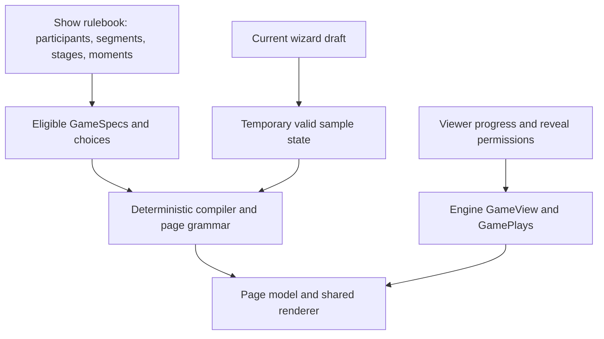

# Higher-fidelity findings and review board

2026-11-10. Open **http://127.0.0.1:4303** for the local comparison. The [board files](../../captures/fidelity-2026-11-10/index.html), captured screens, provider snapshot and asset provenance are ignored review artifacts. The app dev server must remain available on port 3000. Restart the board with `node scripts/dev-test/serve-fidelity-study.js`.

This is a read-only presentation study over the actual app, with separate scoring and sports prototypes. It is not a production UI implementation or a completed review of every generated combination. All application writes through the board are refused. The fixture setup and recorded replay change only local test rows.

## What is different in this pass

- Real season-specific art and 18 cast photos replace the earlier mismatched season poster. Recorded Survivor 49 research/results run through the real engine; the four players and their decisions are deterministic fixtures. Their display names are friendly aliases. Replay dates were shifted consistently so the show's next episode and the games' next moves agree. This is recorded app data, not an independent verification of every broadcast fact.
- Six actual generated games are available: questions, lineup, Outlast, survival pool, bingo and a second lineup variation. The existing generated page, season grid, charts, opponent detail and layered drill-downs are retained. The board is not a replacement collection of manually drawn game templates.
- **A** retains season artwork and the guide on the hub. **B** tries original cinematic atmosphere, a shorter hub feature and the guide opened from a noticeable top control. Both use the actual animated guide, including its manual pause and reduced-motion behavior.
- Nano Banana generated three original atmosphere assets: island, NFL stadium and neutral event. The first model returned a temporary 503; the completed assets came from `gemini-2.5-flash-image` through the repaired MCP. Prompts, hashes, dimensions and model are recorded in `asset-provenance.json`. The same PNG bytes are also saved in the versioned [project asset library](../VISUAL-ASSETS.md) for final implementation. These are illustrative atmosphere, not official show art or a specific photographed venue.
- The NFL proposal uses ESPN's recorded Chiefs–Eagles game on February 9, 2025, with real team logos, result and box-score values. It is labeled a replay. The generic event example uses that same provider snapshot with neutral presentation; it does not establish coverage of every sport or event shape.
- Scoring starts with the actual game engine's episode total, counted participants, moment highlights and bench contributions. It uses game-specific configured values rather than assuming show defaults. A separate interactive calculation is explicitly a sample. The wizard preview can show the game and its scoring, then return to setup. It remains an illustrative recorded game and does **not** yet reflect every live wizard edit.

## Start with scoring comprehension and preview

The important distinction is **recorded fact → eligible participant/moment → configured value → modifiers → counted points**. Showing only a points table leaves a casual player to infer the middle steps. Showing a full rulebook first makes them read before they can understand a single decision.

The scoring prototype now starts with the actual game, person and episode. Counted participant totals and bench points come from viewer-scoped `GameView` history. Expanding a participant reveals the recorded moment highlights and this game's configured moment values. People can inspect another player's revealed result too. Highlights are not presented as a complete event ledger: the existing data supplies up to three reasons, and counts or modifiers can affect the engine's total.

The separate **Try a moment** tab changes sample occurrence counts and whether a participant counts, using this game's values. The recorded total stays unchanged. Games with different scoring, such as a survival pool, show their own rules and pick history instead of a misleading moment-points calculator. Show defaults are available as a separate catalog. The study's fixture commissioner can read the existing rules endpoint; a production normal-user explanation needs a suitable read-only projection and must preserve existing access controls.

The production drill-down should put this explanation beside the actual score: the moment, episode and participant; its recorded answer and verification status; this game's value; why that person counted; any captain, phase or other multiplier; and the final contribution. Separate **not counted**, **recorded as zero**, **not yet known** and **void**. Opening an episode should show what was actually captured, distinct from the catalog of moments that could be captured. Preserve existing reveal and secret-role boundaries.

The wizard's existing three-part game card—before it starts, each episode, to win—is a useful foundation. Keep it. Put **See the game in action** before the longer rules. The user can inspect a move, the season view, what opponents can see, an example result and its point explanation, then return to their exact draft setup.

The eventual preview must use the **current spec**, current rulebook and same compiler/renderer as the real page. Generate a valid temporary sample state, label its outcomes as examples, and avoid real future results. It must not create a league, send notifications, call AI on every opening, or discard wizard edits. Include before/during/after states and the relevant stages and controls. The prototype validates the entry and return pattern; an exact spec-driven playable preview remains implementation work.

## Preserve the generated page; improve its entrances

The current game page already brings social and analytical value together. A person's row, episode square and castaway are useful doors. Keep the couch's season grid, the user's week-by-week view, and the existing stack of detail sheets. The original page is a stronger reference than the earlier mock's simplified leaderboard sheet.

Other people's choices belong here and in useful overview teasers. Use the viewer-scoped `GamePlays` projection: a settled visible pick can be shown; a future hidden choice should show only the state permitted by the rules, such as set/pending. Do not fetch raw hidden decisions merely to make the interface more social. Own-pace ranks may still be provisional.

The six-game Games overview still reaches about **3,396px** in this fixture. Artwork changes do not solve that distribution problem. It repeats full standings before the create-game entry. A next implementation should give each game its name, your relevant state, a visible quick move and a compact legal social signal, with its full season grid and analysis in the existing individual page. Preserve a visible Start action at the overview's beginning. Test an overflow case rather than promising that every possible game list fits one screen.

The hub improved from about **2,323px to 2,234px** with the shorter feature. That small difference is evidence that reducing hero size alone is insufficient. Keep the expressive stage and guide; simplify repeated summaries and make the necessary actions consistent and discoverable. The existing source's sideways move carousel remains a review issue. A vertical summary of all currently due moves is preferable when there is more than one, while each game's quick action remains available.

## Use the actual data grammar

### Show participants and game scoring need explicit scopes

The user's concern is supported by the current reader: `seasonFactsFor` in [season-stats.ts](../../src/lib/server/season-stats.ts) ranks available games, selects one, and uses its settings and rulebook for the show's stats. The [cast explorer](../../src/new/show/cast.tsx) defaults to points. The Rank view names the points source, but Faces and the points heatmap give less context. This can make a show-level view depend on which games are present.

The recommended show scope leads with observed counts, performance, affiliations and episode history through the viewer's mark. If show-default points remain, label them explicitly; do not silently substitute a game's custom points. For sports, genuine provider facts such as basketball points scored remain facts and must not be confused with fantasy points.

The game scope can reuse the same explorer with a visible game context and authorized game identifier. It applies that spec, copied rulebook, custom values and relevant stage. A further seat context explains counted team contributions, including bench, captain and other modifiers. A castaway's potential points under the rules are not automatically the points they earned for every player.

The backend follow-up is to make scope explicit and default the show tab to canonical season facts/rulebook, rather than treating `couchId` as an implicit game-scoring selection. Preserve viewer marks, secret-role guards and permissions in both scopes. Reuse search and detail components; a second unrelated stats application is unnecessary.

The board's **Players B** option now demonstrates that separation with cached cast photos, factual-stat selection, search, Faces/Rank views and episode details using recorded units rather than fantasy point values. A direct link leads to the game context. This is a presentation proposal: it still consumes the existing viewer-filtered stats endpoint, so removing the endpoint's implicit game dependency remains production work. Do not treat hiding the Points option as completing that backend change.

The compiler census exercised 1,337 specs, 14 main-block kinds, 16 answer-control kinds and 92 used places, with no compiler holes or undrawn places in that set. Nine places remain represented by spec metadata without equivalent runtime detail. Those deserve explicit review before a preview implies more detail exists than it does. The census is structural coverage, not a usability study of 1,337 games.

Source: [compiler](../../src/lib/game/game-page/compile.ts), [grammar](../../src/lib/game/game-page/grammar.ts), [page model](../../src/lib/game/game-page/model.ts), [viewer-scoped plays](../../src/lib/game/game-plays.ts), [game renderer](../../src/new/show/game-page.tsx), [rulebook schema](../../src/lib/game/formats/rulebook-schema.d.ts).

## Sports presentation is metadata-driven

NFL is the first representative presentation. Baseball, hockey, soccer, tennis and other ESPN-backed events may need different participants, units, periods, stats and game eligibility. The fallback must use available event and participant metadata, tolerate absent imagery and metrics, and avoid making football concepts universal. The neutral atmosphere asset contains no field, ball, equipment or sport-specific marking.

The NFL prototype keeps the score and result-dependent statistics hidden until explicit reveal, and score reveal does not move the companion clock. Its full-game box score is shown only after reveal; it does not pretend to offer time-aligned statistics. Future provider-specific live/delayed implementations must also guard status, play-by-play, commentary, records, fantasy points and standings. Watching the game is useful without joining a game.

Provider source: [ESPN recorded game and box score](https://www.espn.com/nfl/game/_/gameId/401671889/chiefs-eagles). Local `media-sources.json` records the actual API snapshot URL and public art sources. Scores are intentionally not repeated in this document.

## Verification and limits

The review check passed **33 captured phone states**, each with viewport and full-page images, plus a desktop comparison capture. These include A/B hub, Tonight, Games, Players, game detail, scoring, NFL and fallback; the six generated examples; an opponent sheet; guide; wizard entry/preview; scoring changes; revealed NFL stats; Episodes and Chat. Images loaded, these captured pages had no horizontal overflow, and browser errors were zero. The first hub capture accidentally caught a loading skeleton; the final check waits for the actual feature before taking the screenshot.

Interaction checks passed for opponent detail/return, guide opening/closing, reduced motion, wizard selection retained after preview, sample scoring changes, score hiding/reveal, score/clock independence and the gateway refusing app writes. A separate motion check verified that the original guide rolls and pauses after manual interaction. The guide's review overlay stays below the app's own sheets, supports Escape and keyboard focus wrapping, and returns focus to its launcher. A production implementation should use the existing shared dialog component.

A subsequent focused Players check passed for all 18 cached portraits, absence of a fantasy-points metric, search, ranking, metric switching, recorded-unit details, Escape dismissal and the A/B board routes. It adds two phone captures and a desktop Players comparison in `captures/fidelity-2026-11-10/screens/`; `players-checks.json` records the checks. Browser errors and horizontal overflow were zero in those captured states.

This does not certify accessibility, small-screen/large-text behavior or production performance. The 33-state set does not re-render every watching-only, solo, own-pace and lifecycle state from the earlier inventories. Those remain in the [own-pace](../own-pace-review/evaluation.md) and [previous composition](brief.md) reviews. No claim is made that every engine combination has been visually reviewed.

The kept local fixtures are required for the interactive board. After review, stop its server and use `node scripts/dev-test/blind.js down` when no other replay check is using the same fixture prefix. Captures and generated assets remain available locally.
